# Aplikasi Web To-Do List — React.js & Tailwind CSS

Aplikasi manajemen daftar tugas (*To-Do List*) berbasis frontend yang dikembangkan menggunakan **React.js**, **React Router**, dan **Tailwind CSS** untuk memenuhi Kuis Praktikum Pengembangan Frontend. Seluruh operasi pengelolaan data berjalan secara reaktif menggunakan React State tanpa memuat ulang halaman (*Single Page Application*).

## Identitas Mahasiswa
- **Nama:** Keke Gemintang Padang
- **NIM:** 251401009
- **Kelas:** Lab 5

## Link Website
- **Live Demo (GitHub Pages):** [https://kekegemintangpadang-blip.github.io/251401009_Keke-Gemintang-Padang_Quiz-Pemrograman-Web-Lab-5/](https://kekegemintangpadang-blip.github.io/251401009_Keke-Gemintang-Padang_Quiz-Pemrograman-Web-Lab-5/)

## Fitur Utama & Inovasi

### 1. Manajemen Tugas (CRUD dengan React State)
- **Menampilkan Daftar Tugas (`/`):** Menampilkan seluruh daftar tugas dalam tabel responsif berisi informasi **Judul**, **Status**, **Prioritas**, **Deadline**, dan tombol **Aksi** (Lihat Detail & Hapus).
- **Melihat Detail Tugas (`/todo/:id`):** Menampilkan halaman detail dua kolom berisi **Judul**, **Deskripsi** lengkap, **Status**, **Prioritas**, **Deadline**, serta tombol navigasi **Kembali** dan **Update**.
- **Menambahkan Tugas Baru:** Formulir modal **Tambah Todo** yang dilengkapi validasi input untuk mencegah penyimpanan judul atau deskripsi yang kosong maupun hanya berisi spasi.
- **Memperbarui Tugas:** Mendukung pembaruan lengkap melalui modal **Update Todo** serta fitur **Quick Status Cycle** (klik langsung pada teks status di halaman detail untuk berpindah urutan `to-do` → `in progress` → `done`).
- **Menghapus Tugas:** Dilengkapi modal **Konfirmasi Hapus** sebelum data dihapus dari daftar tugas.

### 2. Pengalaman Pengguna (UX) & Desain Antarmuka
- **Notifikasi Umpan Balik (*Toast Notification*):** Menampilkan pesan konfirmasi otomatis di pojok kanan atas setiap kali pengguna berhasil menambah, memperbarui, atau menghapus tugas.
- **Penyimpanan Persisten (`localStorage`):** Menyimpan data tugas serta preferensi tema di penyimpanan lokal browser sehingga data tidak hilang saat halaman dimuat ulang (`F5`).
- **Sistem Multi-Tema Tersinkronisasi:** Menyediakan tiga pilihan palet warna pastel (**Baby Blue**, **Sakura Pink**, dan **Soft Lavender**) yang otomatis menyelaraskan warna latar belakang, kartu, tabel, halaman detail, dan seluruh modal.

## Struktur Folder Proyek

```text
todo-list-react/
├── public/
│   ├── favicon.svg
│   └── icons.svg
├── screenshots/
│   ├── 01-halaman-utama.png
│   ├── 02-tambah-todo.png
│   ├── 03-tugas-ditambahkan.png
│   ├── 04-detail-tugas.png
│   ├── 05-update-todo.png
│   ├── 06-setelah-update-todo.png
│   ├── 07-konfirmasi-hapus.png
│   ├── 08-setelah-tugas-dihapus.png
│   ├── 09-tema-warna-pink-home.png
│   ├── 09-tema-warna-pink-detail.png
│   ├── 10-tema-warna-purple-home.png
│   ├── 10-tema-warna-purple-detail.png
│   ├── 11-tema-warna-blue-home.png
│   └── 10-tema-warna-blue-detail.png
├── src/
│   ├── assets/
│   │   ├── hero.png
│   │   ├── react.svg
│   │   └── vite.svg
│   ├── components/
│   │   ├── AddTodoModal.jsx
│   │   ├── DeleteConfirmModal.jsx
│   │   └── UpdateTodoModal.jsx
│   ├── data/
│   │   └── dummyTodos.js
│   ├── pages/
│   │   ├── Home.jsx
│   │   └── TodoDetail.jsx
│   ├── App.css
│   ├── App.jsx
│   ├── index.css
│   └── main.jsx
├── .gitignore
├── eslint.config.js
├── index.html
├── package.json
├── package-lock.json
├── README.md
└── vite.config.js
```

## Screenshot Hasil Implementasi

### 1. Halaman Utama (Daftar Tugas)
Menampilkan seluruh daftar tugas beserta informasi judul, status, prioritas, deadline, dan tombol aksi.

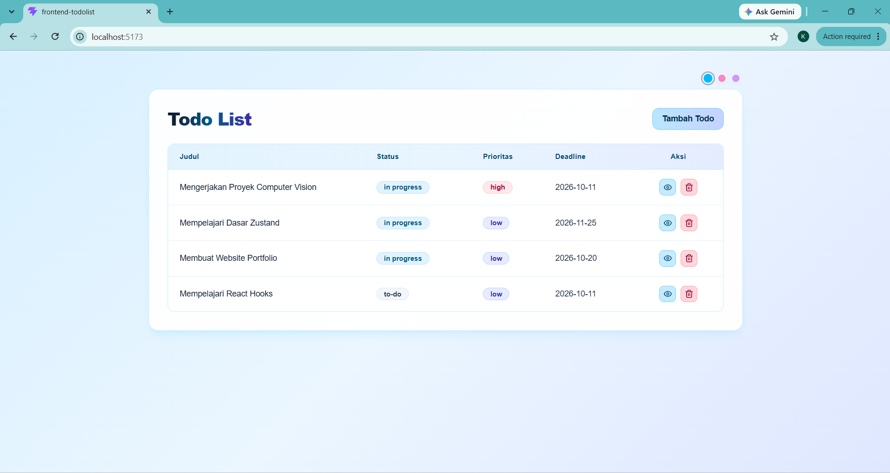

### 2. Modal Tambah Todo
Formulir penambahan tugas baru yang dilengkapi validasi input sebelum disimpan.

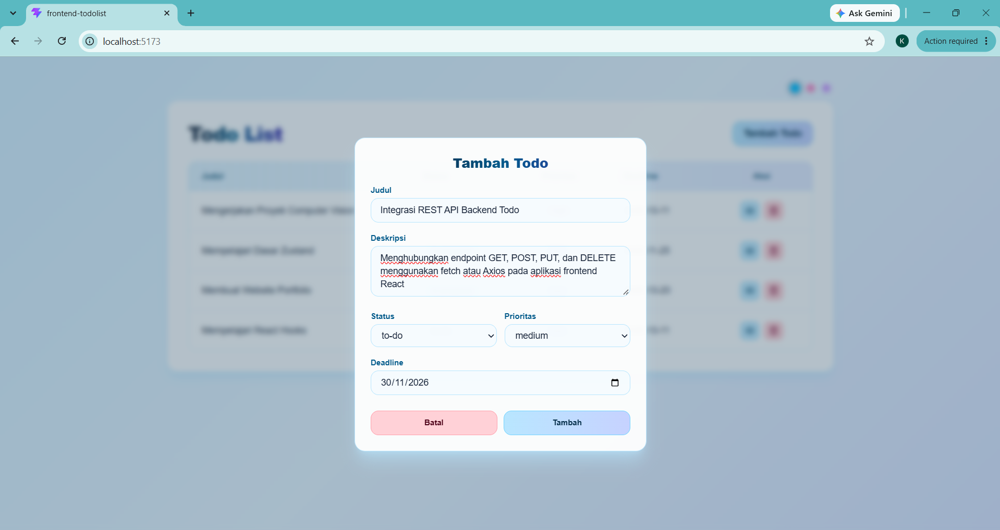

### 3. Hasil Penambahan Tugas & Notifikasi Umpan Balik
Tugas baru langsung muncul di daftar tanpa memuat ulang halaman disertai notifikasi konfirmasi.

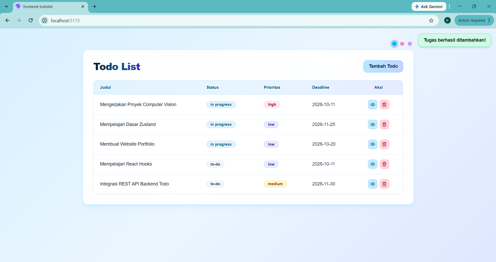

### 4. Halaman Detail Tugas (`/todo/:id`)
Menampilkan informasi lengkap suatu tugas termasuk deskripsi, status, prioritas, dan deadline.

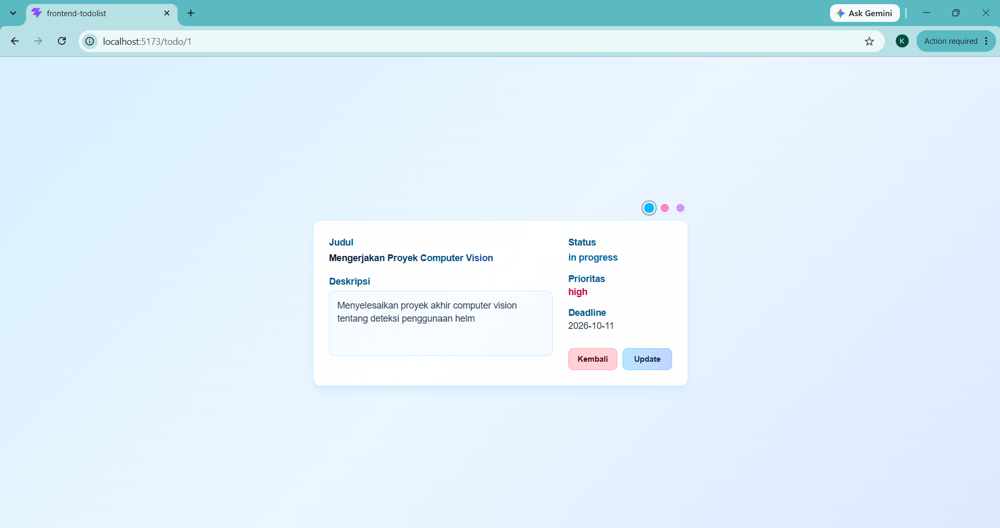

### 5. Modal Update Todo
Formulir pembaruan data tugas yang sudah terisi otomatis dengan data sebelumnya.

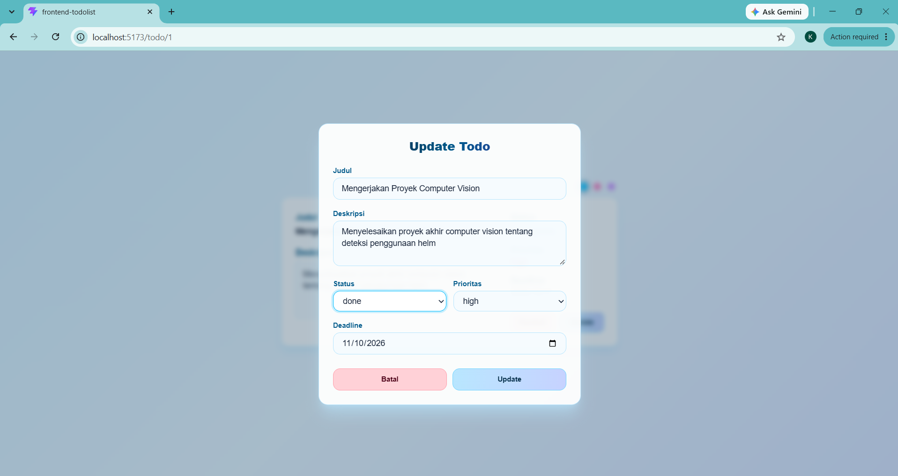

### 6. Hasil Pembaruan Tugas & Notifikasi Umpan Balik
Perubahan data tugas langsung diperbarui pada tampilan disertai notifikasi konfirmasi.

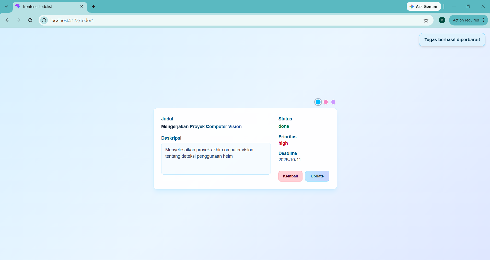

### 7. Modal Konfirmasi Hapus Tugas
Dialog konfirmasi sebelum tugas dihapus secara permanen dari daftar.

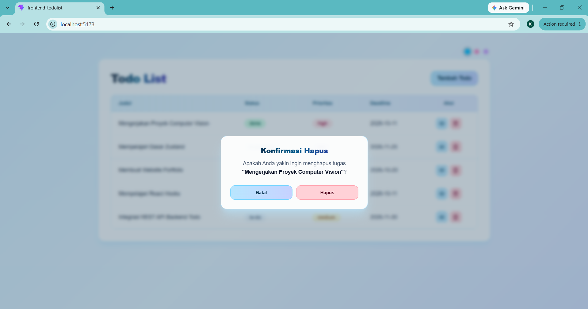

### 8. Hasil Penghapusan Tugas & Notifikasi Umpan Balik
Tugas terhapus dari daftar tanpa memuat ulang halaman disertai notifikasi penghapusan.

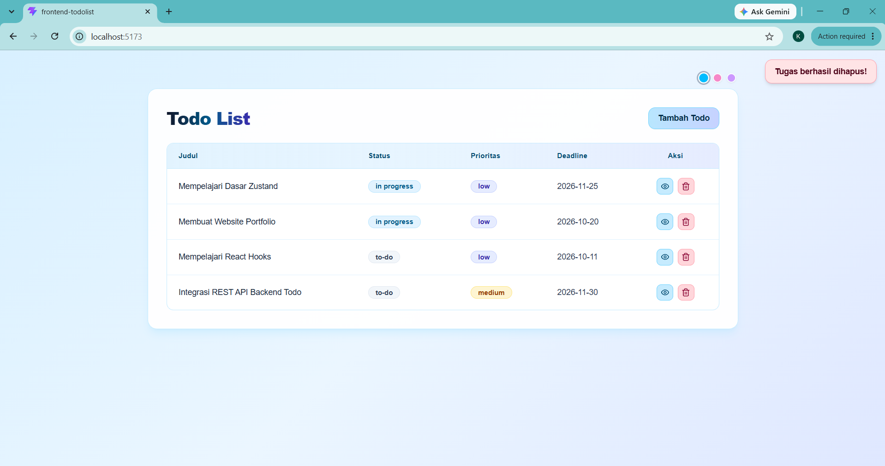

### 9. Variasi Tema Warna — Sakura Pink
**Halaman Utama:**

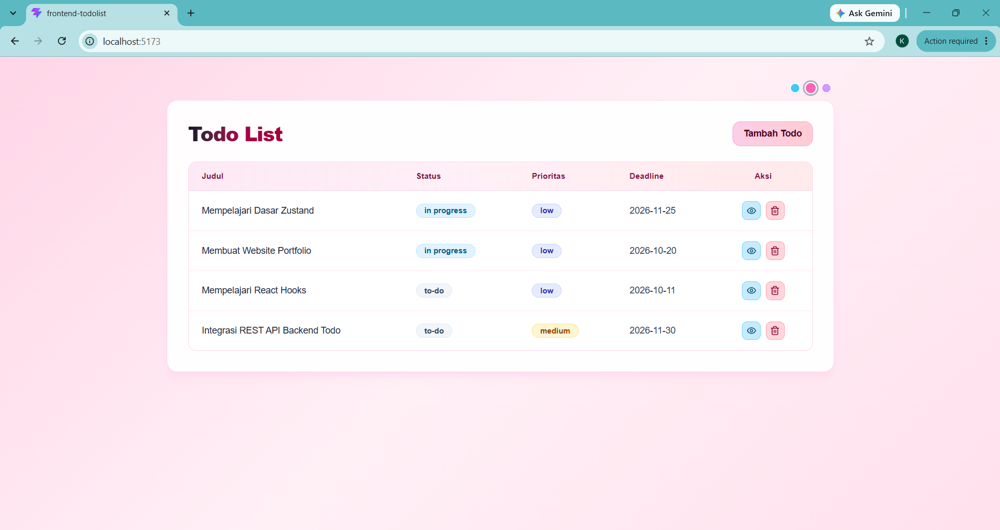

**Halaman Detail:**

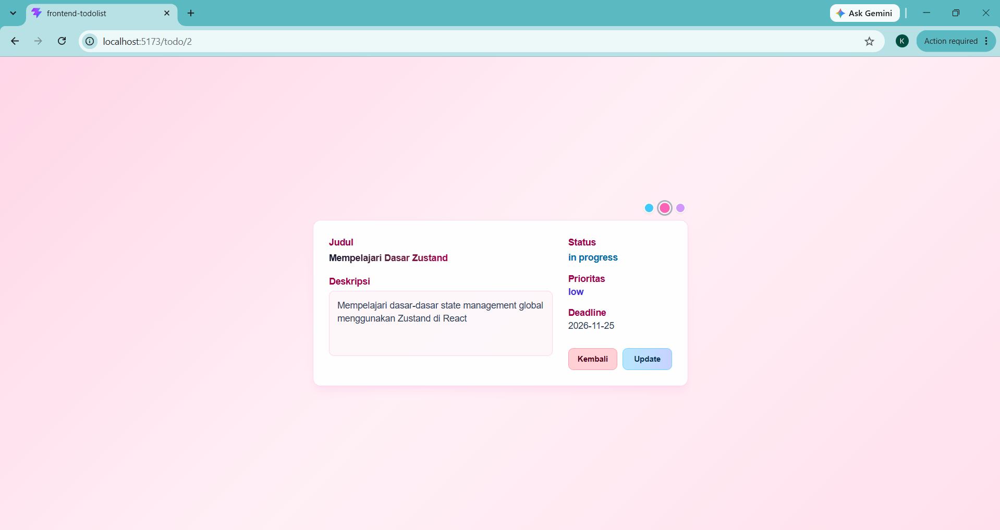

### 10. Variasi Tema Warna — Soft Lavender
**Halaman Utama:**

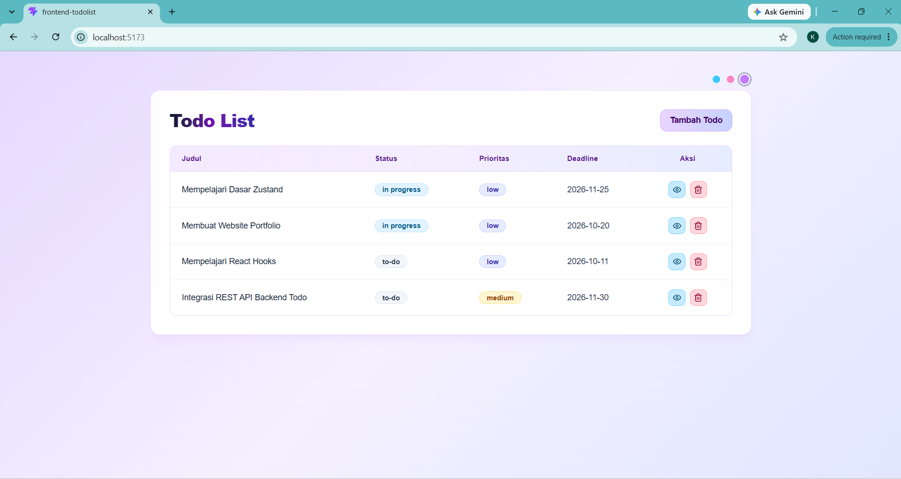

**Halaman Detail:**

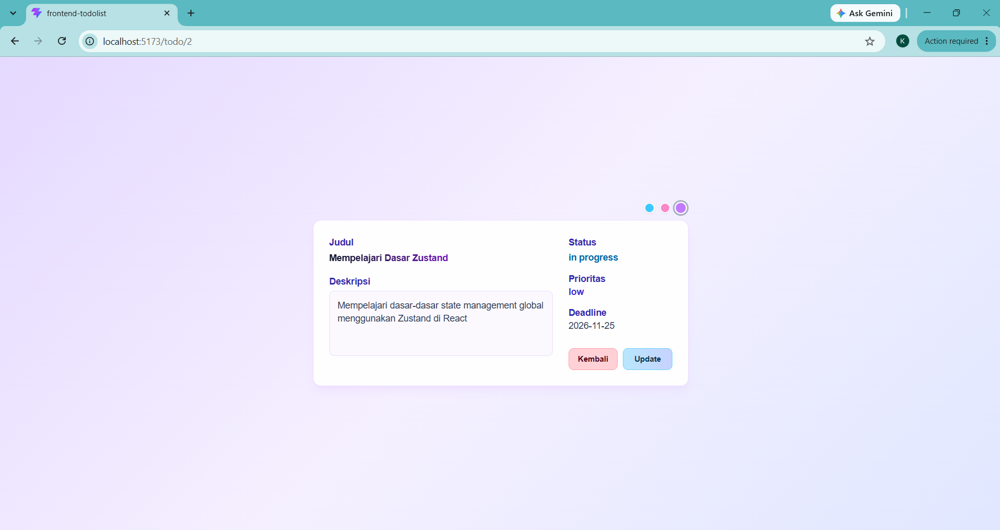

### 11. Variasi Tema Warna — Baby Blue
**Halaman Utama:**

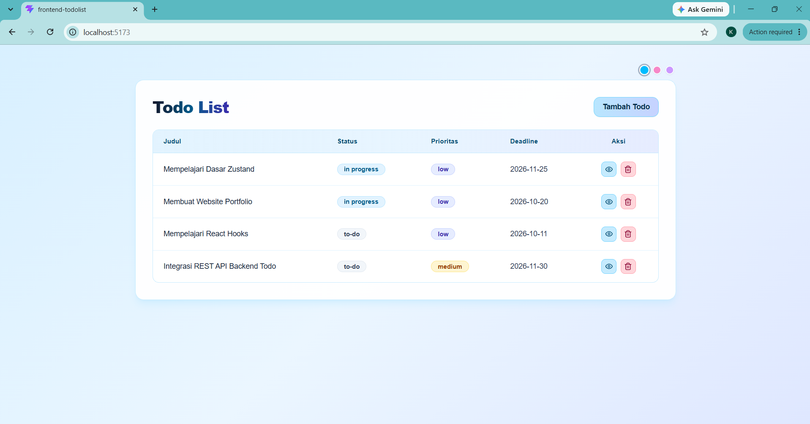

**Halaman Detail:**


